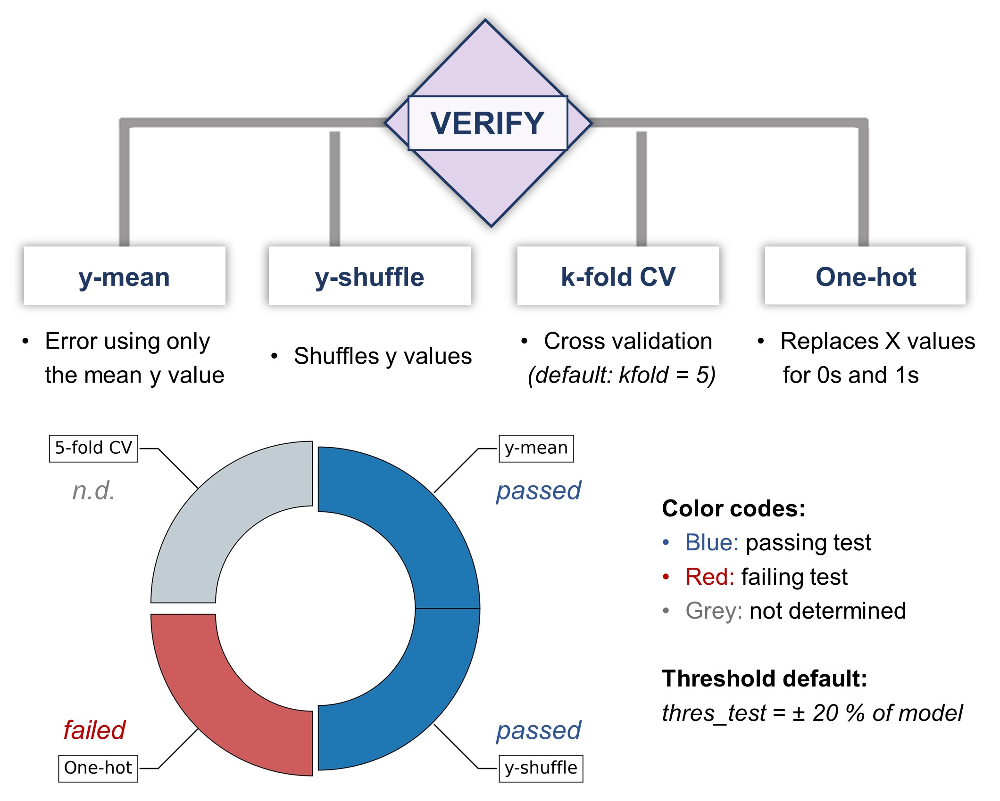

.. verify-modules-start

Predictive ability tests
------------------------

Overview of the VERIFY module
+++++++++++++++++++++++++++++

.. centered:: |verify_fig|

Input required
++++++++++++++

This module uses a GENERATE folder created in a GENERATE job.

Automated protocols
+++++++++++++++++++

*  y-mean test: Calculates the accuracy of the model when all the predicted y values are fixed to the mean of the measured y values (straight line when plotting measured vs predicted y values).  
*  y-shuffle test: Calculates the accuracy of the model after shuffling randomly all the measured y values.
*  onehot test: Calculates the accuracy of the model when replacing all descriptors for 0s and 1s. Continuous descriptors are binarized using their own median as the cutoff (value ≥ median → 1, otherwise → 0). This test is not included when the dataset contains descriptors that are already binary.
*  cluster test (regression only): Calculates the accuracy of a trivial baseline that splits the descriptors into two groups with k-means and predicts each point with the mean y value of its group.
*  Linear baseline (not scored): compares the model with a multivariate linear model (MVL, regression) or a logistic regression (classification) using the same descriptors and CV.

Technical information
+++++++++++++++++++++

Each test is compared with the original model through the relative difference of their errors (RMSE or MCC by default). A test fails when the "flawed" model is less than 15% worse than the original model, it is unclear between 15% and 30%, and it passes when it is more than 30% worse.
The CheckML score converts this difference into a gradual penalty (see the CheckML score section).
Lastly, the VERIFY module generates a bar plot summarizing the test outcomes. This visual representation distinguishes between passed, unclear and failed tests, using blue, yellow and red colors, respectively.

Example
+++++++

An example is available in **Examples/Use of individual modules**.

.. verify-modules-end
